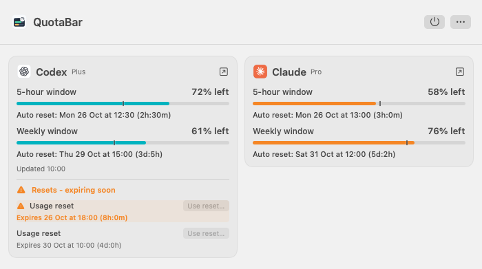

# QuotaBar

A native macOS menu bar app for Codex (ChatGPT) and Claude subscription usage. See your remaining five-hour and weekly usage, scheduled reset times, and any reset credits and expiry dates the provider reports.

Use Codex, Claude, or both. Independent community project, with no analytics or hosted backend. Not affiliated with or endorsed by OpenAI or Anthropic.

[Install](#install) | [First launch](#first-launch-and-provider-setup) | [Usage](#usage) | [Screenshots](#screenshots) | [Troubleshooting](#troubleshooting)

## Status

The current source version is **0.4.0**. The latest public Stable release is **0.3.0**. Earlier development builds used higher internal version numbers.

This README describes the current `main` branch, including any [Unreleased changes](CHANGELOG.md#unreleased). For the packaged 0.3.0 release, see [its README](https://github.com/YogevSitton/quotabar/blob/v0.3.0/README.md).

The current source includes an in-app updater with a default **Stable** channel and an opt-in **Preview** channel. Preview builds are published automatically from eligible merges to `main`; installation and recovery have not yet been qualified on real Macs. The published 0.3.0 app predates this updater. See [Releases and in-app updates](docs/UPDATES.md).

Requires an Apple Silicon Mac running macOS 14 or later. Codex and Claude live usage have been checked locally. Claude's usage interface is experimental; optional Claude reset credits and actual reset redemption remain unverified. Downloaded builds are ad-hoc signed and are not notarized by Apple. See [verification status](docs/VERIFICATION.md).

## Install

Requires an **Apple Silicon Mac with macOS 14 or later**. You can use Codex, Claude, or both.

**No Terminal is needed to install the downloaded app.**

1. Download [QuotaBar-0.3.0.zip](https://github.com/YogevSitton/quotabar/releases/download/v0.3.0/QuotaBar-0.3.0.zip) from [GitHub Releases](https://github.com/YogevSitton/quotabar/releases).
2. Double-click the ZIP in Finder to extract it.
3. Drag **QuotaBar.app** into **Applications**.
4. Open **QuotaBar** from Applications. Its icon appears in the menu bar at the top of your screen.

### If macOS blocks the app

Downloaded builds are not notarized by Apple. If macOS says the developer cannot be verified and you trust the download, first try opening the app, then go to **System Settings > Privacy & Security > Open Anyway** and confirm **Open**. See [Apple's explanation](https://support.apple.com/en-us/102445).

Continue with [First launch and provider setup](#first-launch-and-provider-setup) to connect your subscription.

### Updates

Published versions through 0.3.0 predate the updater. To move to the first updater-enabled release, quit QuotaBar with the power button, download the new ZIP from [GitHub Releases](https://github.com/YogevSitton/quotabar/releases), extract it, replace the app in Applications, and reopen it. That first migration is manual.

In an updater-enabled release, **More > Updates...** opens a separate Updates window:

- Choose Stable (the default) or Preview on each Mac. Preview follows eligible successful merges to `main` after the activation boundary.
- Checks run about hourly and downloads happen automatically by default; you can turn either off and use **Check for Updates**.
- Nothing installs until you click **Install and Relaunch** for the exact build shown. Switching from Preview to Stable never downgrades.

Update checks need no GitHub account, token or command-line tool. macOS may ask for App Management permission again on later updates. Builds made from source never install updates. See [Releases and in-app updates](docs/UPDATES.md) for setup, permissions and recovery, and [CHANGELOG.md](CHANGELOG.md) for version changes.

## First launch and provider setup

QuotaBar runs in the **menu bar at the top of your screen**. It has no Dock icon or main app window. Click its gauge icon or provider percentages to open the popup.

Set up either provider below, or both. QuotaBar reuses the official tools' subscription sign-in; you do not paste passwords or API keys into QuotaBar.

### Codex

1. Install the ChatGPT/Codex desktop app or the official Codex CLI. OpenAI's [desktop setup](https://developers.openai.com/codex/quickstart/) and [CLI setup](https://learn.chatgpt.com/docs/codex/cli) explain those options.
2. Sign in through that official app or CLI with your **ChatGPT subscription**. API-key-only authentication cannot provide subscription usage.
3. Open QuotaBar's popup. It detects supported installations automatically and reads the existing sign-in. There is no separate Codex sign-in button in QuotaBar.

### Claude

1. Install [Claude Desktop](https://claude.com/download) or the [official Claude Code CLI](https://code.claude.com/docs/en/setup#install-claude-code). QuotaBar's usage reader requires Claude Code **2.1.309 or later**.
2. Open QuotaBar's popup. It automatically checks for an existing **Claude Code subscription sign-in**. Being signed in only to Claude Desktop does not necessarily provide that CLI sign-in.
3. If **Connect Claude** appears, click it. QuotaBar prepares a verified official helper if needed, checks the saved sign-in, and opens the official browser login only when required. Finish authorization in your browser. Progress, cancel and errors stay in the popup; **Sign-in help** opens optional recovery help.

To change Claude accounts later, sign in to the other account in Claude Code; QuotaBar follows that sign-in. A provider with no detected local installation is hidden. Startup, polling and retrying usage never open browser sign-in or download a helper.

### Check that setup worked

After a successful read, each connected provider shows its applicable five-hour and weekly remaining percentages in the popup and menu bar, for example `72%/61%`. A supported reading with no five-hour limit, currently Codex Pro, shows `∞/61%` and **No 5-hour limit** in the popup. Codex refreshes automatically every minute; healthy Claude reads are at least 2 minutes 10 seconds apart. Wake checks respect Claude's saved request deadline, and failures cause longer waits. Missing or unverified values stay unavailable; see [Troubleshooting](#troubleshooting) if a card or reading is missing.

To start QuotaBar automatically, open the popup's **More** (ellipsis) menu and enable **Launch at login** after moving the app into Applications.

## Usage

Each connected provider has its transparent logo followed by `5h%/weekly%`, such as `93%/91%`. These are **remaining** percentages. A supported reading with no five-hour limit shows `∞` in the first position, such as `∞/61%`; the weekly limit still applies. When five-hour usage is exhausted, its reset countdown replaces the percentage, such as `2h13m/45%`. When the weekly window is exhausted, only its weekly countdown appears. Percentages gradually turn red between 50% and 10% remaining; infinity and countdowns stay uncolored. A dash means a current value is unavailable.

When a reported manual reset expires within 3 days, a small countdown chip follows that provider's percentages: orange with the days left (`2d`), then hours or minutes left (`18h`, `45m`) in its last 24 hours. The existing yellow-orange color gradually blends toward red from 24 hours left, reaching full red at 12 hours and staying red until expiry. The time is rounded down, so it never overstates how long you have. Hover over the menu bar item to see each provider's next reset expiry with its date and countdown.

Click the menu bar item to open the compact popup. Installed providers appear side by side with their applicable five-hour and weekly meters, automatic reset times and reported reset credits. **No 5-hour limit** replaces the five-hour meter and reset time when supported by the reading. Reset and expiry times include a countdown on the same line; the timezone is in the tooltip. The popup does not scroll. Longer inventories, descriptions, saved readings and recovery information open in a separate resizable Details window through contextual links. Additional/model limits and extra usage are intentionally not displayed.

A subtle contrasting tick on each current usage meter marks the remaining quota expected for even use across that window. Hover over the meter for the comparison and percentages; there is no separate pace label. The comparison uses the reading's original timestamp. This reference approaches zero near reset time, even when your actual balance remains high. It assumes even use, allows a two-percentage-point tolerance, and is not a forecast. Saved readings, expired windows, and missing or inconsistent reset times show no pace marker.

Reported manual reset offers expiring within 3 days have an orange warning icon and highlighted expiry; from 24 to 12 hours left they gradually blend to full red, matching the menu bar chip's transition. Exact expiry dates and countdowns remain visible. The reset heading also warns when an expiring offer is outside the inline row limit. Upcoming expiries appear before expired offers. Unknown expiry dates and historical inventories never receive a current expiring-soon warning or menu bar chip.

The header contains **Quit** (power) and **More** (ellipsis). More contains **Launch at login** and **Updates...**, which opens the separate Updates window. The app version appears at the bottom right of the popup. Refresh is automatic, with separate provider intervals and saved Claude retry deadlines; there is no manual refresh control or Settings window. You can Command-drag the menu bar item to reposition it. The item fits its content: ordinary percentage changes keep its width, while reaching or leaving 100%, dropping below 10%, a countdown, `∞` or a reset chip can make it slightly wider or narrower. Width changes wait until the popup closes.

## Screenshots

Source UI rendered offline with synthetic usage and reset offers. These examples show the pace markers and reset-expiry warnings added in 0.2.0, but predate the bottom-right version label, and the menu bar reset countdown chip and 3-day warning tier added in 0.3.0. They also predate the Updates menu entry and separate Updates window. They are not live account readings or evidence of reset redemption.




See [dark appearance, saved-reading examples and image provenance](docs/SCREENSHOTS.md).

## Troubleshooting

| What you see | What to do |
| --- | --- |
| A provider is missing | Check that its desktop app or CLI is installed in a supported location. Wait about 30 seconds or reopen the popup for installation detection. See [installation discovery details](docs/PROVIDER-INTEGRATIONS.md). |
| Codex has no current values | Check the detected official app or CLI's subscription sign-in. An API-key-only account cannot supply subscription limits. |
| Claude shows **Connect Claude** | Follow the [Claude setup steps](#claude) and finish the official browser flow if requested. |
| Claude shows a usage error | Wait for the displayed automatic retry. **Retry usage**, restarting and changing accounts respect the saved waiting period. An old cache, unavailable service or incompatible CLI does not by itself mean you need to sign in again. |
| A card shows **Saved reading** | Its timestamp and percentages describe an earlier sample. Those values never supply current menu bar percentages. **Last saved reading** opens historical details. |
| An optional checksum check says a file is missing | Check that Terminal is in the folder containing both downloads, with the exact filenames shown in the command. If your browser automatically extracted and removed the ZIP, download the original ZIP again. |
| An optional checksum check says `FAILED` | Do not open that download. Download both matching files again from the same release and repeat the check. |
| An optional source build fails | Make sure Xcode has finished setup and the selected toolchain includes Swift 5.9+ and a macOS 14+ SDK. Keep the error message for a bug report, with personal paths redacted. |

The external Usage buttons open [ChatGPT usage settings](https://chatgpt.com/settings/usage) and [Claude usage settings](https://claude.ai/settings/usage), where you can check your account directly.

For help, use the [bug template](.github/ISSUE_TEMPLATE/bug_report.md). Include your macOS version, Mac chip, QuotaBar version and what happened. Remove personal data from screenshots; never include raw CLI replies or private authorization links. Report security issues privately, following [SECURITY.md](SECURITY.md).

## Freshness and privacy

Monitoring sends read-only control requests through the official CLIs, with no user/model prompts or inference requests. QuotaBar does not purchase credits, change subscriptions, refresh tokens, or read/write credential stores. The official CLIs manage their own authentication. QuotaBar does not read conversation logs, scrape browser credentials, alter Keychain access, or configure Claude settings.

Claude reads use only `initialize`, `get_binary_version` and `get_usage`, always with `skip_behaviors: true`. The reader disables project settings, tools, hooks, external MCP servers, telemetry, automatic updates and session persistence. A bounded `claude auth status` check can classify a failure using its authentication method and exit status; raw replies are not logged.

Claude Code may return a cached reading even when its usage request fails. QuotaBar matches non-secret account/cache metadata in `~/.claude.json` and preserves its original `fetchedAtMs`. Without a new sample recorded during the request, a reused sample must still be less than 60 seconds old when the read finishes. Otherwise it counts as a failed refresh immediately, even before the sample reaches two minutes old. This conservatively includes a sample that ages past 60 seconds while the helper starts. Missing provenance or a newly returned sample at least two minutes old fails validation. After a response passes validation, its original sample can supply current percentages for less than four minutes, allowing the next scheduled read to finish. Expired quota windows require a fresh reading. Missing or malformed values stay unknown, and Claude's undocumented `five_hour: null` is not treated as no limit. No-limit handling uses narrow provider-specific response rules; see [provider integration details](docs/PROVIDER-INTEGRATIONS.md#five-hour-limit-applicability).

Claude failures wait five minutes before retrying, doubling the delay after repeated failures up to one hour. The request deadline survives retries, restarts and account changes, and is shared by QuotaBar copies running as the same user on this Mac. The newest account-matched reading remains clearly labeled **Saved reading** during the wait, with its original timestamp; it never supplies current menu percentages. A failed refresh makes current percentages unavailable immediately, even within the four-minute display lifetime. This reduces QuotaBar's request pressure but cannot guarantee that Claude will never rate-limit requests. Optional status-line snapshots and local Claude usage history supply historical percentages only. See [provider integration details](docs/PROVIDER-INTEGRATIONS.md).

There is no hosted backend or analytics. Quota snapshots stay in memory except for the separately enabled local status-line exporter. Claude request timing and retry state are stored locally without account identifiers or credentials. A confirmed Codex reset stores local recovery metadata, never credentials.

### Optional status-line exporter

`scripts/capture-claude-statusline.py` saves only sanitized usage fields, the organization ID used to match accounts, and the capture time. The atomic snapshot is private (0600) at `~/Library/Application Support/QuotaBar/claude-statusline.json`. It requires an active Claude Code session and is labeled historical.

The exporter is never installed automatically. Configuring it changes `~/.claude/settings.json` and requires your explicit consent. Preserve or chain any existing status-line script.

## Use a saved reset

**Codex:** A supported live credit has **Use reset**. A fresh account-verified reading and a separate confirmation are required. Cancel is the default. Only **Use 1 reset** sends the request, targeting the selected account and credit. QuotaBar checks them again and persists the UUID idempotency key before sending. It never buys or automatically selects another reset.

An uncertain result blocks new requests. **Review saved reset request** requires a new confirmation and reuses only the original account, credit and key. Restarting never replays it. An unreadable recovery record disables redemption. The private recovery record is `~/Library/Application Support/QuotaBar/pending-codex-reset.json` (directory 0700, file 0600). Stale readings, expired credits and unsupported reset types cannot start a reset. Count-only and unsupported inventories use the official Usage page.

**Claude:** **Use a reset on Claude** opens the official Usage page for your own selection and confirmation. QuotaBar does not implement an undocumented Claude reset request.

**Actual reset redemption has not been verified. No reset action or confirmation was exercised and no reset credit was spent during development verification.** Optional Claude reset-credit fields are undocumented and have not been verified against a live account.

## Limitations

- Claude support depends on an experimental control interface and may break after CLI changes.
- Missing provider fields remain unknown; full reset-credit parity is not promised.
- Account connection reliability has not been validated across a broad range of accounts and installations.
- Builds have been checked only on Apple Silicon. Intel support is unverified.
- Packaged releases are ad-hoc signed, not notarized. Developer ID signing and notarization remain future work.
- Preview builds publish automatically from `main`, but installation, permission prompts and recovery remain unqualified on real Macs.

## Optional checksum verification

This extra check compares the ZIP against the release's published checksum. **It is optional and requires Terminal.** It does not replace Developer ID signing or notarization.

Download the matching `QuotaBar-0.3.0.zip.sha256` file from the same [release](https://github.com/YogevSitton/quotabar/releases/tag/v0.3.0) and keep it beside the ZIP. If both files are in Downloads, open **Terminal** from **Applications > Utilities** and run:

```sh
cd ~/Downloads
shasum -a 256 -c QuotaBar-0.3.0.zip.sha256
```

The expected result is `QuotaBar-0.3.0.zip: OK`. For a different release or folder, use its matching filename or folder. If you choose to run this check and it reports `FAILED`, download both matching files again before opening the app.

## Build from source

This is an optional alternative for development or Unreleased changes. To install the ready-made app, use the [ZIP download](#install) above.

1. Install [Xcode](https://developer.apple.com/xcode/resources/) with Swift 5.9 or newer, choosing a version compatible with your macOS. Open Xcode once and finish its setup. An existing Swift 5.9+ toolchain with Apple's command-line tools and a macOS 14+ SDK also works.
2. Open Terminal and run the following commands, one line at a time. Start in the folder where you want to keep the source code:

   ```sh
   git clone https://github.com/YogevSitton/quotabar.git
   cd quotabar
   ./scripts/build.sh
   open dist
   ```

   A successful build prints `Built .../dist/QuotaBar.app`. The last command opens the output folder in Finder. If the build fails, fix the reported error before continuing.
3. Drag **QuotaBar.app** from that folder into **Applications**, then open it from Applications. Continue with [First launch and provider setup](#first-launch-and-provider-setup).

The app has no external Swift package dependencies. If you already cloned the repository, use that checkout instead of cloning again. Contributor build and verification steps are in [CONTRIBUTING.md](CONTRIBUTING.md#build-and-review).

## Development

Read [CONTRIBUTING.md](CONTRIBUTING.md) and [AGENTS.md](AGENTS.md). Current verification is compilation and static review only. Never exercise resets, send live reset requests or consume credits during development. CI compiles the app and test targets without executing tests.

```sh
./scripts/build.sh
swift build --build-tests --disable-sandbox
python3 scripts/audit-public-tree.py --public-docs
python3 scripts/check-workflow-trust.py
python3 scripts/check-release-docs.py
codesign --verify --deep --strict dist/QuotaBar.app
```

Set `QUOTABAR_BUILD_PATH` to put build intermediates elsewhere. `scripts/package-release.sh` creates a zip and SHA-256 checksum and verifies the extracted app's signature; it uploads nothing. Normal builds use committed artwork. `scripts/build-icon.sh` explicitly regenerates artwork and strips metadata. [Assets/ICON.md](Assets/ICON.md) records its provenance.

Report vulnerabilities through [GitHub private vulnerability reporting](https://github.com/YogevSitton/quotabar/security/advisories/new), following [SECURITY.md](SECURITY.md). Use redacted or synthetic examples in issues.

## License and trademarks

QuotaBar's own code, documentation and original artwork are under the [MIT License](LICENSE), copyright 2026 Yogev Sitton.

OpenAI, ChatGPT and Codex names and marks belong to OpenAI; Anthropic and Claude names and marks belong to Anthropic. Provider names and artwork are excluded from the MIT grant and identify their respective integrations. QuotaBar is not affiliated with, endorsed by or sponsored by either provider.
