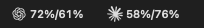
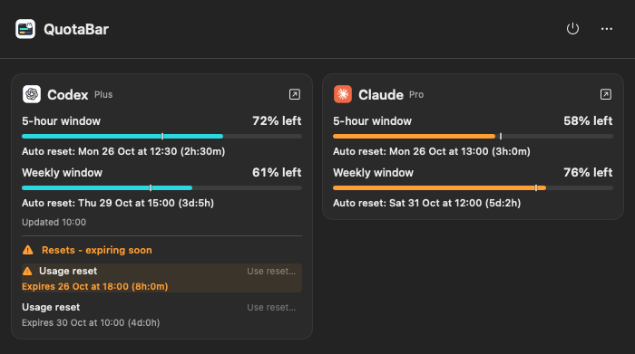
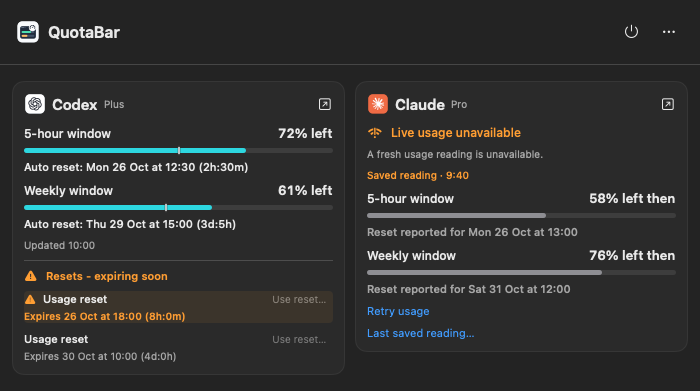
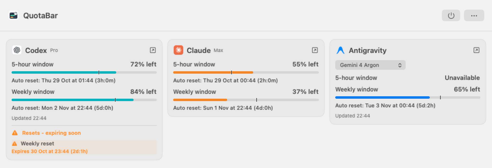
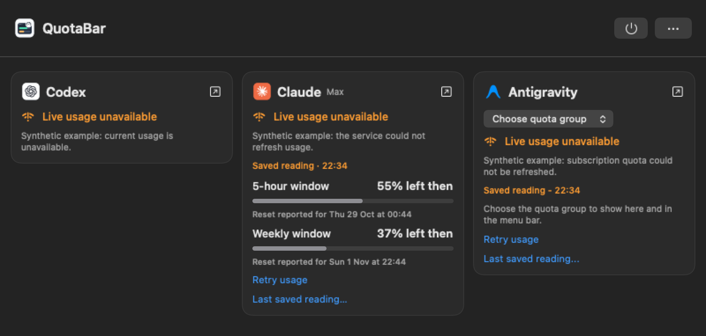

# Screenshots

These images show the UI from source revision [`84756c0`](https://github.com/YogevSitton/quotabar/commit/84756c0), rendered on 26 October 2026. They illustrate the pace markers and reset-expiry warnings added in [0.2.0](../CHANGELOG.md#020---2026-10-26), but predate its bottom-right version label, and the menu bar reset countdown chip and move of expiry warnings to 3 days (orange) and 24 hours (red) in [0.3.0](../CHANGELOG.md#030---2026-10-27). They also predate the Unreleased Updates menu entry and separate Updates window described in [the update guide](UPDATES.md). They are not captures of a release bundle.

All usage, plans, dates and reset offers are synthetic. No account identifiers, credentials, authorization links or desktop content appear in the images. The fixture clock is 26 October 2026 at 10:00 in Europe/London. The dates and countdowns illustrate the UI; they are not current provider readings.

## Light appearance

Menu bar percentages are remaining quota, in five-hour/weekly order. The marks have transparent backgrounds; a neutral background is added around the rendered strip for readability here.

The popup keeps both providers side by side. Contrasting meter ticks mark the even-use reference. The first synthetic Codex reset expires in eight hours and receives an orange warning; under the 0.3.0 tiers it would be red. Claude has no reported reset inventory in this example. Reset buttons are disabled because the fixture has no verified account.

## Dark appearance

The same fixture in dark appearance, including the contrasting pace ticks and highlighted reset expiry.

## Saved reading

The Claude sample is twenty minutes old and marked historical. Its meters turn gray, its percentages say "left then", and its original timestamp remains visible. Pace ticks are absent from historical meters. The Codex card still shows its current synthetic sample. **Retry usage** and **Last saved reading** remain available in the Claude card.

## Capture method and limits

The images were rendered from the actual `Dashboard` and `MenuBarArtwork` views using AppKit hosting views and bitmap capture at native resolution in a temporary copy of the source. Only that copy replaced installation discovery and login-item status with fixed values, skipped recovery-file loading, and supplied a fixed clock and synthetic snapshots. The production sources were unchanged.

The preview did not launch the normal app delegate, start polling, load account or recovery data, invoke sign-in, or activate any control. No reset action, confirmation or request was exercised. PNG metadata was stripped, and each final image was visually reviewed.

These are content renders, without the macOS menu bar, popover arrow, window shadow or desktop. They demonstrate presentation, not live provider behavior, popup anchoring or successful reset redemption. See [verification status](VERIFICATION.md) for those limits.

## Unreleased Antigravity examples

These two examples use source revision [`2a21981`](https://github.com/YogevSitton/quotabar/commit/2a21981fb244d8c975937a8501a00f1dff936eab), rendered on 28 October 2026. Every quota, group label and reset offer is synthetic. In particular, the weekly-only Gemini 4 Argon example demonstrates missing-window handling; it is not evidence of the actual plan or quota shape.

An isolated AppKit harness linked the actual SwiftUI views and testable object files while excluding `Main.o`. It constructed `AppState(loadLocalState: false)`, so no installation discovery, login-item status, local preferences or recovery records were loaded. It never called `start()` or any provider, sign-in, reset, update or other control. The example dates are relative to the render clock, approximately 22:44 Europe/London. The harness has no packaged app version metadata, so the conditional bottom-right version label is absent.

Eight views were checked at 1020- and 800-point widths, in light and dark appearances, with healthy and missing/stale readings. Their measured content heights were 349-382 points under a 600-point cap. The two saved examples were visually reviewed for clipping, labels and private data after the missing-selection placeholder was fixed; PNG metadata was stripped. These are content renders without a real popover anchor, not live connection or provider validation.

## Maintaining the images

- Use the source revision being documented and record it here. Keep release and Unreleased examples clearly distinguished.
- Prefer isolated offline rendering with synthetic data. Disable discovery, account/recovery loading and monitoring before constructing the preview state. Do not launch the normal app or invoke controls to capture examples.
- Review light and dark appearances, labels, dates, countdowns, pace ticks and saved-reading treatment at the final image size.
- Strip metadata with `python3 scripts/strip-png-metadata.py docs/screenshots/*.png`, stage the images, and run `python3 scripts/audit-public-tree.py --public-docs` from the repository root.
- Review every image visually for personal data and outdated UI. The audit checks metadata and tracked README image targets; it cannot inspect text inside pixels.
